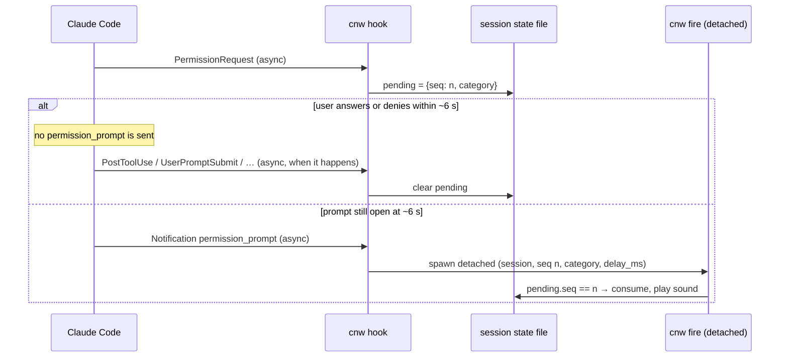

# agent-harness-notifications — Specification

Status: draft for review · Date: 2026-10-25 · Target: Claude Code ≥ 2.1.288

## 1. Problem

Orca (and Claude Code itself) emits one undifferentiated "attention" signal. Orca plays a single
audio file for every delivered notification, triggered on the agent's working→idle transition. An
engineer running several agents cannot tell, from the sound alone, whether an agent:

- is blocked on a question it asked,
- is blocked on a tool-permission or plan approval,
- finished its work,
- finished but asked something in its closing text,
- failed (API error, usage limit),
- has been ignored for a while.

Each of those warrants a different context-switch decision. This project maps each kind of agent
need to a user-chosen sound so the engineer can decide *by ear* whether to leave their current task.

## 2. Goals

1. Classify Claude Code lifecycle events into a fixed set of **attention categories** (§5).
2. Let the user map each category to a sound file, a delay, and an enabled flag (§7).
3. Be **non-invasive**: never alter Claude Code's behaviour, never answer or block a prompt, never
   modify Orca's hooks or Claude Code settings files.
4. Suppress false alarms when the user answers a prompt before the delay expires (§6).
5. Run on macOS, Linux, and Windows (§9).

## 3. Non-goals

- Agents other than Claude Code (Codex, OpenCode, Grok, …) running inside Orca.
- Desktop notification banners, chips, badges — Orca already provides these; this project is audio only.
- Auto-approving, denying, or answering anything.
- Text-to-speech, per-project config overrides, quiet hours, focus detection.
- Model-based classification of end-of-turn text (heuristic only, §5.2).

## 4. Research basis

Verified against the [hooks reference](https://code.claude.com/docs/en/hooks) and an instrumented
interactive session on Claude Code 2.1.301 (macOS). Facts the design depends on:

| Fact | Source |
|---|---|
| `PermissionRequest` fires **immediately** when Claude blocks on the user, with `tool_name` and full `tool_input`. | Probe |
| `AskUserQuestion` dialogs arrive as `PermissionRequest` with `tool_name: "AskUserQuestion"`; `tool_input.questions[]` carries question text and options. | Probe |
| Plan approval arrives as `PermissionRequest` with `tool_name: "ExitPlanMode"`; `tool_input.plan` carries the plan. | Probe |
| `Notification`/`permission_prompt` fires ~6 s after the dialog (deferred by keystrokes in terminals) with only a generic message, and is **identical** for questions and tool approvals ([#74052](https://github.com/anthropics/claude-code/issues/74052), open). | Probe, docs |
| `PermissionRequest` does **not** fire for sandbox network-request prompts; only `Notification`/`permission_prompt` does. | Docs |
| `Stop` carries `last_assistant_message` and `background_tasks`. `Stop` does not fire on user interrupt. | Probe, docs |
| `Notification`/`idle_prompt` fires 60 s after `Stop` if the user has not typed and no background agent runs (fixed in 2.1.288, [#93672](https://github.com/anthropics/claude-code/issues/93672)). | Probe, changelog |
| `SubagentStop` fires after every main-turn `Stop` from Claude's internal prompt-suggestion agent (empty `agent_type`). | Probe, docs |
| `StopFailure` replaces `Stop` on API errors; `error` identifies the type. | Docs |
| `Elicitation` fires immediately when an MCP server requests input; `elicitation_dialog`/`elicitation_url_dialog` notifications follow ~6 s later. | Docs |
| Hook entries from plugins **merge** with settings-file hooks; Orca's hooks in `~/.claude/settings.json` are unaffected. | Docs |
| Orca registers hooks for `Stop`, `PermissionRequest`, `SubagentStop`, etc., but not `Notification`, and exports `ORCA_WORKTREE_ID`, `ORCA_PANE_KEY`, `ORCA_TAB_ID` into the agent's environment. | Local `~/.claude/settings.json`, `~/.orca/agent-hooks/claude-hook.sh` |

Minimum version 2.1.288 covers: `permission_prompt` in SDK-hosted sessions (2.1.233), sandbox
network-prompt notification (2.1.246), `PermissionRequest` in `--print` (2.1.268), `idle_prompt`
during background agents and skipped `PermissionRequest` hooks (2.1.288).

## 5. Attention categories

Category IDs are stable config keys.

| ID | Meaning | Trigger | Default delay | Default enabled |
|---|---|---|---|---|
| `question` | Agent asked a structured question | `permission_prompt` notification while an `AskUserQuestion` prompt is registered (§5.1) | 0 ms | yes |
| `plan_approval` | Agent wants a plan approved | `permission_prompt` notification while an `ExitPlanMode` prompt is registered | 0 ms | yes |
| `permission` | Agent wants a tool call approved | `permission_prompt` notification while any other tool's prompt is registered; or an orphan `permission_prompt` (§5.1) | 0 ms | yes |
| `mcp_input` | An MCP server needs input | `elicitation_dialog`/`elicitation_url_dialog` notification, registered or orphan | 0 ms | yes |
| `done_question` | Turn finished, closing text asks something | `Stop`, empty `background_tasks`, question heuristic true (§5.2) | 0 ms | yes |
| `done` | Turn finished | `Stop`, empty `background_tasks`, heuristic false | 0 ms | yes |
| `done_background` | Turn finished, background work still running | `Stop`, non-empty `background_tasks` | 0 ms | no |
| `error` | Turn ended on an API error | `StopFailure` | 0 ms | yes |
| `usage_limit` | Usage limit stopped the agent | `Notification`/`quota_auto_resume_disabled` or `quota_auto_resume_stale` | 0 ms | yes |
| `idle_reminder` | Finished turn ignored for 60 s | `Notification`/`idle_prompt` | 0 ms | yes |

Ignored events (classified as no category): `SubagentStop`, `Notification` types `auth_success`,
`elicitation_complete`, `elicitation_response`, `agent_needs_input`, `agent_completed`,
`quota_auto_resume_fired`, `plugin_notification`, and any unknown type.

### 5.1 Prompt registration and the "still unanswered" trigger

`PermissionRequest` fires immediately but says nothing about whether the prompt gets answered:
after the user approves a tool, the next event is `PostToolUse`, which fires only when the tool
finishes. Claude Code's own `permission_prompt` / `elicitation_dialog` / `elicitation_url_dialog`
notification is the reliable "still unanswered" signal: it fires ~6 s after the prompt appears
(deferred by keystrokes in that terminal) and is **not sent** when the prompt is answered or denied
first (verified on 2.1.310 for an approved slow command, a quickly answered `AskUserQuestion`, and a
denial).

- `PermissionRequest` **registers** the prompt: it stores the category (`question` for
  `AskUserQuestion`, `plan_approval` for `ExitPlanMode`, `permission` otherwise) as the session's
  pending prompt. No sound is scheduled. `Elicitation` registers `mcp_input` the same way.
- A `permission_prompt` notification while a `question`/`plan_approval`/`permission` prompt is
  registered plays that category. An `elicitation_*` notification while `mcp_input` is registered
  plays `mcp_input`.
- A notification with no matching registered prompt is an **orphan** — played as `permission` or
  `mcp_input` — only if the session recorded no `PermissionRequest` / `Elicitation` in the
  preceding 30 s. Otherwise it is dropped. The orphan path covers sandbox network-request prompts.

### 5.2 End-of-turn question heuristic

Input: `Stop.last_assistant_message`.

1. Remove fenced code blocks (```` ``` ```` / `~~~` delimited).
2. Split into paragraphs on blank lines; take the last non-empty paragraph.
3. For each line in that paragraph, trim trailing whitespace and the characters `` *_)"'`> ``.
4. Result is `true` if any line then ends with `?` (ASCII) or `？` (full-width).

Empty or missing message → `false`.

## 6. Delay and cancellation

Prompt sounds are triggered by Claude's "still unanswered" notification (§5.1), so the effective
minimum latency for `question`, `plan_approval`, `permission`, and `mcp_input` is Claude Code's
~6 s gate. `delay_ms` adds extra wait after the trigger for every category. During that extra wait a
registered prompt can still be cancelled.



- **Registering events:** `PermissionRequest`, `Elicitation`. A new registration in the same session
  replaces the old one (new `seq`).
- **Cancelling events** (same `session_id`):
  - `PostToolUse`, `PostToolUseFailure` — only when `tool_name` and `agent_id` (absent for the main
    agent) equal the registered request's. Parallel tool calls in one batch must not cancel a prompt
    for a different tool; two parallel calls to the same tool awaiting approval can still cancel each
    other's sound (accepted).
  - `PermissionDenied`, `UserPromptSubmit`, `ElicitationResult`, `Stop`, `StopFailure`, `SessionEnd` —
    unconditionally.
  - `PreToolUse` is **not** a cancelling event: it fires for the same tool call *before*
    `PermissionRequest` (observed), so an out-of-order async delivery would cancel the prompt it
    precedes.
- A registered prompt's sound is cancellable (it carries the prompt's `seq`); an orphan's is not.
- **Delay 0:** the handler still spawns the detached player so the hook returns immediately.
- `done*`, `error`, `usage_limit`, `idle_reminder` never register; they play after their configured
  delay without cancellation.
- **Deny path (verified, 2.1.310):** denying fires no hook event, and no `permission_prompt` is sent
  for a prompt closed within ~6 s, so a quick denial is silent. A prompt left open past ~6 s and then
  denied has already sounded, which is correct.
- **Hosts:** in SDK-hosted sessions (Claude Desktop, VS Code) `permission_prompt` fires ~6 s after the
  prompt without keystroke deferral (hooks reference); the same rules apply.

## 7. Configuration

File: TOML.

| OS | Path |
|---|---|
| macOS, Linux | `$XDG_CONFIG_HOME/cnw/config.toml`, else `~/.config/cnw/config.toml` |
| Windows | `%APPDATA%\cnw\config.toml` |

`CNW_CONFIG` environment variable overrides the path. A missing file means built-in defaults (§5).
Every category without a configured `sound` plays its **bundled clip**, `<plugin root>/sounds/<kokoro_voice>/<id>.wav`
(the binary finds the root two levels above its own directory, `bin/<os>-<arch>/`). `enabled = false`
still silences a category. `cnw init` writes a commented default file.

The bundled clips are spoken phrases generated with Kokoro-82M (Apache-2.0 weights; one directory
per voice) by `scripts/make-sounds.sh`, which runs `scripts/make-sounds.py` under uv (dependencies
pinned in `scripts/make-sounds.py.lock`) and then, with ffmpeg, trims silence, limits peaks to
16.5 dB above the clip's loudness, and applies one linear gain to −18 LUFS (true peak ≤ −1 dBFS),
writing 16-bit mono 22.05 kHz WAV. The config key `kokoro_voice` picks the voice for the clips and
for Kokoro-spoken names ([voice selection design](2026-10-29-voice-selection-design.md)).

```toml
# All durations are in milliseconds.
volume = 0.8              # 0.0–1.0; applied where the backend supports it (§9)
cooldown_ms = 1500        # minimum gap between two sounds for the same session

[categories.question]
sound = "~/Sounds/cnw/question.wav"
delay_ms = 2000          # extra wait after Claude's ~6 s "still unanswered" notification

[categories.permission]
sound = "~/Sounds/cnw/permission.wav"

[categories.done]
sound = "~/Sounds/cnw/done.wav"

[categories.done_background]
enabled = false

[categories.idle_reminder]
sound = "~/Sounds/cnw/nudge.wav"
volume = 0.4              # per-category override
```

Per-category keys: `sound` (path; `~` expanded; a relative path resolves against the config file's
directory), `enabled` (bool), `delay_ms` (int ≥ 0), `volume` (0.0–1.0). Unset keys inherit the §5
defaults and the top-level `volume`. On Windows, write paths as TOML literal strings
(`'C:\Users\me\ding.wav'`) or with forward slashes.

Validation: unknown category IDs and unknown keys are reported by `cnw doctor`. The hook path never
fails on bad config: it logs the error and plays nothing.

## 8. Components

### 8.1 Plugin layout

The plugin's `name` is `cnw`. Claude Code rejects third-party plugin names starting with `claude-`.

```text
agent-harness-notifications/
├── .claude-plugin/plugin.json
├── .claude-plugin/marketplace.json  # "cnw-marketplace": cnw (github, ref release), cnw-dev ("./")
├── hooks/hooks.json
├── sounds/<voice>/<category>.wav # bundled default clips, one directory per Kokoro voice
└── bin/
    ├── cnw                       # POSIX sh launcher: selects the platform binary
    ├── darwin-arm64/cnw
    ├── darwin-amd64/cnw
    ├── linux-amd64/cnw
    ├── linux-arm64/cnw
    └── windows-amd64/cnw.exe
```

The launcher maps `uname -s`/`uname -m` to the directory (`MINGW*|MSYS*|CYGWIN*` → `windows-amd64`)
and `exec`s the binary with all arguments and stdin. If no binary matches, it exits 0 silently.

`bin/*/` is gitignored on `main`. A `v*` tag triggers `.github/workflows/release.yml`, which tests,
runs `scripts/build.sh`, and runs `scripts/publish-release.sh`: after checking the tag against the
`version` in `plugin.json` and `package.json`, it commits the tagged tree plus the five binaries onto
the `release` branch (parent: the previous `release` head, so the branch only fast-forwards). The
marketplace entry `cnw` installs from that branch through a `github` source with `ref: "release"`,
which both Claude Code and omp honour; `marketplace add` itself needs no ref, which omp could not
express. `cnw-dev` (`"./"`) installs the marketplace's own checkout and needs a local build.

### 8.2 `hooks/hooks.json`

Every handler is shell form: `"\"${CLAUDE_PLUGIN_ROOT}/bin/cnw\" hook"`.

All handlers are async: none needs to block Claude Code. Registration (`PermissionRequest`,
`Elicitation`) precedes the notification that triggers its sound by ~6 s, so async delivery order is
not a concern.

| Event | Matcher | Mode | Why |
|---|---|---|---|
| `PermissionRequest`, `Elicitation` | `*` | async | Register the prompt's category |
| `Notification` | `*` | async | Prompt trigger, idle, usage limit |
| `Stop`, `StopFailure` | `*` | async | Classification and cancellation |
| `PostToolUse`, `PostToolUseFailure`, `PermissionDenied` | `*` | async | Cancellation only |
| `UserPromptSubmit`, `ElicitationResult`, `SessionEnd` | `*` | async | Cancellation only |

### 8.3 `cnw` binary (Go, static, no cgo)

| Command | Behaviour |
|---|---|
| `cnw hook` | Read one event JSON from stdin; classify (§5); update state (§6); spawn `cnw fire` when a sound is due. Always exits 0 and writes nothing to stdout, so it never emits a hook decision. |
| `cnw fire --session ID --seq N --category C --delay MS` | Internal. Detached. Sleeps, re-checks pending state when `seq` > 0, enforces cooldown, plays the sound under the global playback lock. |
| `cnw play CATEGORY` | Play a category's configured sound now, ignoring delay and cooldown. For tuning the mapping. |
| `cnw init` | Write the default config if none exists. |
| `cnw notify CATEGORY --session ID [--cwd DIR] [--pending] [--after MS]` | Direct signal (§13). Schedules the category's sound after `MS` + `delay_ms`; `--pending` first registers it as the session's prompt so `resolve` cancels it. `--cwd` enables the project announcement (announcement design §9). |
| `cnw resolve --session ID` | Direct signal. Clears the session's pending prompt. |
| `cnw turn-end --session ID [--cwd DIR] [--error]` | Direct signal. Clears the pending prompt and plays `error`, else `done_question` when the final reply on stdin passes §5.2, else `done`. `--cwd` as for `notify`. |
| `cnw doctor` | Report: Claude Code version (≥ 2.1.288), config path and validation errors, each configured sound file's existence, audio backend found, Windows Git Bash presence, and the last 20 classified events. |

Packages:

- `event` — payload structs for the fields used; unknown fields ignored.
- `classify` — pure function `(event, recentState) → category | none | cancel`. Includes §5.1 and §5.2.
- `state` — per-session JSON file plus the event log.
- `config` — load, defaults, validation.
- `audio` — backend detection and playback (§9).

### 8.4 State

Directory: `$CNW_STATE_DIR` when set, else `<user cache dir>/cnw/state/` (`os.UserCacheDir`: macOS
`~/Library/Caches`, Linux `$XDG_CACHE_HOME` or `~/.cache`, Windows `%LocalAppData%`). It does not use
`$CLAUDE_PLUGIN_DATA`: Claude Code exports that only to hook processes, so `cnw doctor` run from a
shell would read a different directory than the hooks write.

- `sessions/<session_id>.json` — `{pending: {seq, category, tool_name, agent_id, created_ms} | null, last_permission_ms,
  last_elicitation_ms, last_played_ms}`. Writes are write-temp-then-rename. Files untouched for
  7 days are deleted opportunistically by `cnw hook`.
- `play.lock` — exclusive lock serialising playback across sessions, so overlapping agents' sounds
  stay distinguishable. `cnw fire` waits at most 15 s for the lock, then drops the sound (15 s covers
  a full clip plus spoken name; see the announcement design §5).
- `events.log` — JSON Lines: timestamp, `hook_event_name`, `session_id`, `cwd`, category or
  `ignored`/`cancel`, play outcome, and `ORCA_WORKTREE_ID` / `ORCA_PANE_KEY` when present. Rotated at
  1 MiB, keeping one previous file. Message text is not logged.

## 9. Audio backends

External players; first one found on `PATH` wins.

| OS | Backend order | Volume |
|---|---|---|
| macOS | `afplay -v <vol>` | yes |
| Linux | `pw-play --volume <vol>`, `paplay --volume <vol×65536>`, `aplay`, `powershell.exe` | yes, yes, no, no |
| Windows | `powershell -NoProfile -Command (New-Object Media.SoundPlayer '<path>').PlaySync()` | no |

`powershell.exe` only resolves under WSL, where interop puts it on `PATH`; it is the last resort
because WSL images ship no Linux player even though WSLg runs a PulseAudio server. The sound path is
converted with `wslpath -w` first. `cnw doctor` reports that backend as a WARN and names
`pulseaudio-utils` as the fix, and names it too when no backend at all is found on WSL.

WAV is the only format guaranteed on every platform. Other formats work where the backend supports
them (e.g. `afplay` plays MP3/M4A). A missing backend or file is logged; nothing is played.

## 10. Coexistence with Orca

- The plugin adds hooks alongside Orca's; neither sees the other's output.
- To avoid double audio, the user disables Orca's sound under **Settings → Notifications** and keeps
  Orca's system notification, chip, and Dock badge. `cnw doctor` prints this as a reminder when
  `ORCA_PANE_KEY` is set.
- The same plugin works in a plain terminal outside Orca.

## 11. Verification

Unit tests (Go, table-driven, payloads recorded from real sessions as fixtures):

| ID | Asserts |
|---|---|
| T1 | `PermissionRequest` with `AskUserQuestion` / `ExitPlanMode` / `Bash` registers `question` / `plan_approval` / `permission` and plays nothing. |
| T2 | `permission_prompt` with a registered prompt → that prompt's category, cancellable; with none and no `PermissionRequest` in the last 30 s → `permission`; with none but a cancelled `PermissionRequest` within 30 s → dropped; registrations in another session don't count. Same rules for `elicitation_*` / `mcp_input`. |
| T3 | Heuristic (§5.2): trailing `?`, `?**`, `?)`, full-width `？`, `?` only inside a code block (false), `?` only in an earlier paragraph (false), empty message (false). |
| T4 | `Stop` with non-empty `background_tasks` → `done_background` regardless of the heuristic. |
| T5 | A newer registration replaces the older in the same session; a cancelling event clears only its own session; `PostToolUse` for a different `tool_name` or `agent_id` does not cancel. |
| T6 | Config: defaults merge, per-category volume override, unknown keys reported, malformed file → hook plays nothing and exits 0. |

Smoke tests (manual, real Claude Code session with the plugin loaded via `claude --plugin-dir`):

| ID | Scenario | Expected |
|---|---|---|
| T7 | Bash permission prompt; deny it within 1 s | No sound (verified during planning: no hook event and no `permission_prompt` on deny) |
| T8 | Bash permission prompt left unanswered | `permission` sound at ~6 s, once |
| T8b | Bash permission prompt for a 15 s command; approve within 2 s | No sound |
| T9 | Prompt Claude to call `AskUserQuestion`; answer within 1 s | No sound |
| T10 | Same, unanswered | `question` sound at ~6 s |
| T11 | Plan mode → `ExitPlanMode` | `plan_approval` sound |
| T12 | Turn ending in "Want me to continue?" vs. a plain summary | `done_question` vs. `done`; one `idle_reminder` 60 s later |
| T13 | Two Orca worktrees finishing within 200 ms | Two sounds, played sequentially |
| T14 | `cnw hook` wall time for `PermissionRequest` | < 20 ms p95 on macOS arm64 |
| T15 | Repeat T8 and T12 on Linux and on Windows (Git Bash) | Same results |

## 12. Constraints and risks

- **Windows requires Git for Windows.** The launcher is a POSIX sh script; Claude Code runs hook
  commands through Git Bash when it is installed and through PowerShell otherwise. Without Git Bash,
  the hook fails to start and no sound plays. `cnw doctor` reports this.
- **`permission_prompt` mislabelling (#74052).** The category comes from the registered
  `PermissionRequest`, not from the notification, so the mislabelling does not matter. If Anthropic
  adds a dedicated question notification type, treat it like `permission_prompt` in §5.1.
- **Prompt latency floor.** Prompt sounds cannot come sooner than Claude Code's ~6 s notification
  gate; `delay_ms` only lengthens it.
- **Questions asked in prose mid-turn** produce no event until `Stop`; the §5.2 heuristic has false
  positives (rhetorical questions) and false negatives (imperatives like "Let me know which.").
- **Hook schema drift.** Unknown events and fields are ignored; unknown `Notification` types are
  logged as `ignored` so the user can see them in `cnw doctor`.

## 13. omp adapter

omp (Oh My Pi) has no Claude-style hooks; its extensions receive in-process events. `omp/cnw.ts`,
declared in the root `package.json` (`omp.extensions`), maps them to the direct signals in §8.3.
omp installs it from the same `.claude-plugin/marketplace.json` (`omp plugin marketplace add
<owner/repo>`, `omp plugin install cnw@cnw-marketplace`) as a copied snapshot, so a new release (or,
for `cnw-dev`, a rebuild) needs a reinstall.

omp reports prompt resolution directly, so no "still unanswered" notification is needed. The
extension registers a prompt with `notify --pending --after 6000` (the same ~6 s gate as Claude
Code) and cancels it with `resolve`. Events from subagents (`ctx.agent.kind === "sub"`) are ignored.

| omp event | Signal |
|---|---|
| `tool_approval_requested` / `tool_approval_resolved` | `notify permission --pending` / `resolve` |
| `tool_call` / `tool_execution_end` for the `ask` tool | `notify question --pending` / `resolve` |
| `plan_review_requested` / `plan_review_resolved` | `notify plan_approval --pending` / `resolve` |
| `agent_end`, last assistant `stopReason: "aborted"` | `resolve` only (an interrupt is silent) |
| `agent_end`, otherwise (skipped when `willContinue`) | `turn-end` (`--error` for `stopReason: "error"`), then a 60 s timer → `notify idle_reminder` |
| `input`, `agent_start`, `session_shutdown` | cancel the idle timer |

Session ids come from `ctx.sessionManager.getSessionId()`. Verified live on omp 18.12.6: open
question, open approval, quick answer, quick deny, closing question, idle reminder, and interrupt.

## Appendix A. Recorded payloads (Claude Code 2.1.301, trimmed)

```json
{"hook_event_name":"PermissionRequest","session_id":"1225b42c-…","tool_name":"AskUserQuestion",
 "tool_input":{"questions":[{"question":"Do you prefer red or blue?","header":"Color",
 "options":[{"label":"Red","description":"You prefer red."},{"label":"Blue","description":"You prefer blue."}],
 "multiSelect":false}]}}
{"hook_event_name":"Notification","session_id":"1225b42c-…","message":"Claude needs your permission",
 "notification_type":"permission_prompt"}
{"hook_event_name":"PermissionRequest","session_id":"1225b42c-…","tool_name":"Bash",
 "tool_input":{"command":"touch /tmp/ccprobe/probe_file && ls /tmp/ccprobe",
 "description":"Create probe file and list ccprobe directory"}}
{"hook_event_name":"PermissionRequest","session_id":"1225b42c-…","tool_name":"ExitPlanMode",
 "tool_input":{"plan":"echo hello\n","planFilePath":"/Users/me/.claude/plans/example-plan.md"}}
{"hook_event_name":"Notification","session_id":"1225b42c-…",
 "message":"Claude Code needs your approval for the plan","notification_type":"permission_prompt"}
{"hook_event_name":"Stop","session_id":"1225b42c-…","stop_hook_active":false,
 "last_assistant_message":"I ran `touch /tmp/ccprobe/probe_file && ls /tmp/ccprobe`. The command succeeded. …",
 "background_tasks":[],"session_crons":[]}
{"hook_event_name":"Notification","session_id":"1225b42c-…","message":"Claude is waiting for your input",
 "notification_type":"idle_prompt"}
```

Observed timings in that session: `PermissionRequest` +0 s → `permission_prompt` +6 s;
`Stop` +0 s → `idle_prompt` +60 s.
